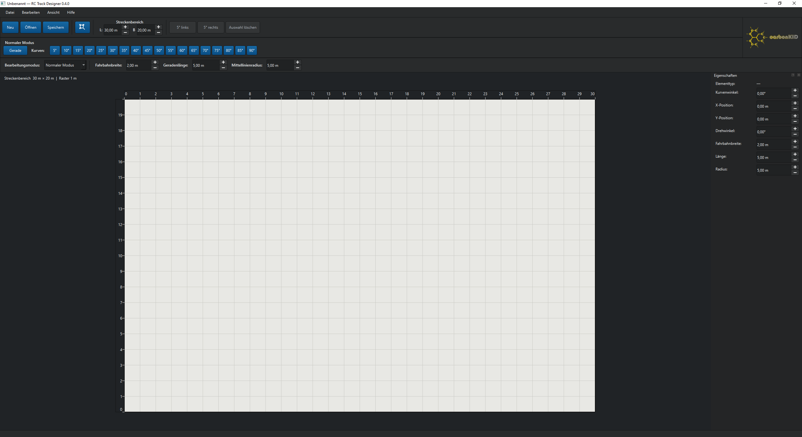
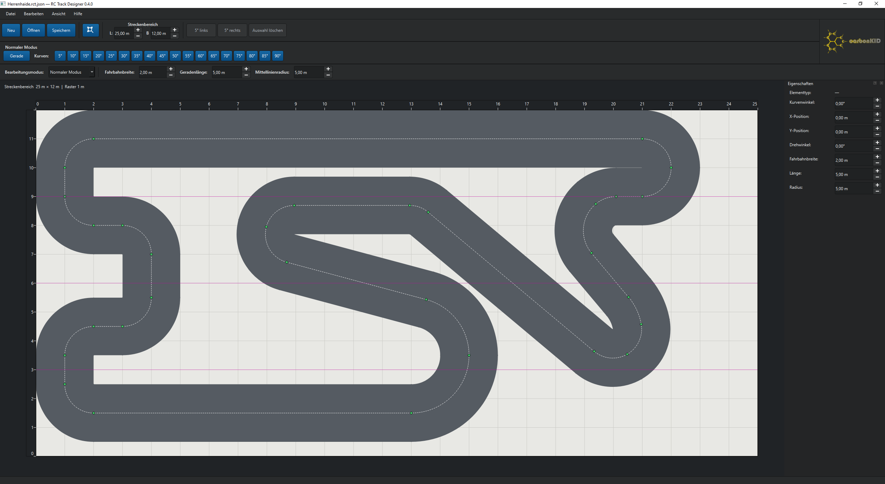
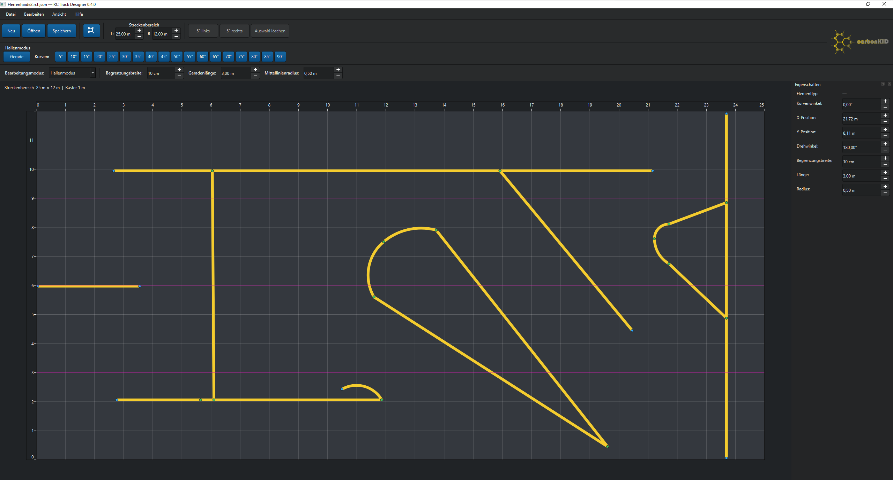

# RC Track Designer

RC Track Designer v0.4.0 Beta 2 ist ein maßstabsgetreuer 2D-Layouteditor für RC-Car-Rennstrecken. Die Anwendung verwendet intern Meter; Kurvenradien beziehen sich auf die Mittellinie.

Neben klassischen Streckenlayouts richtet sich der Editor an Vereine und Fahrer im **Indoor Carpet Racing**, die **Temporary Track Layouts** (temporäre Streckenlayouts) planen. Ein typischer Einsatz sind Teppichstrecken in gemeinsam genutzten Sporthallen von Schulen oder Sportvereinen: Die Strecke wird für Training oder Rennen aufgebaut und anschließend wieder abgebaut.

## Screenshots

<table>
  <tr>
    <th width="33%">Programmübersicht</th>
    <th width="33%">Streckenmodus – fertiges Layout</th>
    <th width="33%">Hallenmodus – Begrenzungslayout</th>
  </tr>
  <tr>
    <td></td>
    <td></td>
    <td></td>
  </tr>
</table>

## Streckenmodus und Hallenmodus

- **Streckenmodus (Track Mode):** Hier planst du den Fahrbahnverlauf mit gefüllten Geraden und Kurven sowie einstellbarer Fahrbahnbreite.
- **Hallenmodus (Carpet Mode):** Hier planst du die Anordnung der Begrenzungen für temporäre Teppichstrecken. Die Begrenzungen werden als durchgehend gelbe, maßstabsgetreue Geometrie auf anthrazitfarbenem Hallenteppich dargestellt; eine gefüllte Fahrbahn wird nicht automatisch erzeugt.
- Die Moduswahl befindet sich in der Maßleiste. Vor dem Umschalten müssen ungespeicherte Änderungen gespeichert werden; Abbrechen lässt das aktuelle Projekt unverändert. Der gewählte Modus beginnt anschließend mit einem leeren Streckenbereich gleicher Abmessungen.
- Gerade Begrenzungen verwenden Längen in Metern. Kurven verwenden Mittellinienradius in Metern und Winkel in Grad. Die Begrenzungsbreite wird als 5, 10, 15, 20 oder 25 cm eingegeben; intern werden alle Werte in Meter gespeichert.
- Begrenzungen dürfen frei stehen, mehrere unabhängige Ketten bilden oder magnetisch verbunden werden. Sie verbinden sich ausschließlich mit anderen Begrenzungen, niemals mit normalen Fahrbahnelementen.
- Mit einem Rechtsklick auf eine gerade Begrenzung lassen sich zusätzliche Magnetpunkte einfügen; ein Rechtsklick auf einen solchen Punkt entfernt ihn wieder. An jedem Anschluss von Begrenzungen können mehrere Geraden und Kurven zusammentreffen, auch an bereits verbundenen Segmentenden. Verbundene Segmentenden lassen sich direkt als Gelenk ziehen; angrenzende Geraden ändern dabei Länge und Winkel, Kurven ihren Mittellinienradius, während die jeweils gegenüberliegenden Anschlüsse stehen bleiben. Zusatzpunkte lassen sich entlang ihrer Geraden verschieben. Wird die Trägergerade verschoben, bleiben die Verbindungen ebenfalls wie Gelenke erhalten.
- Auswahl, Mehrfachauswahl, Verschieben, 360°-Drehung, Kopieren, Löschen und Undo/Redo funktionieren in beiden Modi gleich.

## Installation und Start

Vorausgesetzt wird Python 3.11 oder neuer.

```powershell
python -m venv .venv
.venv\Scripts\python -m pip install -e ".[test]"
.venv\Scripts\python -m rc_track_designer
```

Im Entwicklungs-Checkout geht es auch ohne Installation:

```powershell
$env:PYTHONPATH = "src"
.venv\Scripts\python -m rc_track_designer
```

## Bedienung

- `Datei > Neu` legt einen Streckenbereich mit Länge und Breite an.
- Oben eine Gerade oder einen neutralen Kurvenwinkel wählen und zum Platzieren in den Streckenbereich klicken. `Esc` beendet den Platziermodus.
- Klicken wählt ein Element; Ziehen verschiebt es. Werkzeugleiste oder `Strg+Links`/`Strg+Rechts` dreht um 5°. Bei einem einzeln ausgewählten Segment drehen die Pfeiltasten `Links`/`Rechts` direkt; Gedrückthalten dreht kontinuierlich weiter. `Entf` oder `Auswahl löschen` im Rechtsklick-Menü löscht die Auswahl.
- Fahrbahnbreite, Geradenlänge und Mittellinienradius gelten für neue Elemente und ändern zugleich das ausgewählte Element.
- Geradenlängen und Kurvenradien lassen sich über die Plus-/Minus-Schaltflächen in 0,5-m-Schritten ändern.
- Der kleinste zulässige Mittellinienradius entspricht der halben Fahrbahnbreite. Die innere Fahrbahnkante darf dabei in einem Punkt zusammenlaufen, aber nicht über den Kurvenmittelpunkt hinauslaufen oder sich selbst überschneiden.
- Länge und Breite des Streckenbereichs sind jederzeit in der Werkzeugleiste änderbar; die Ansicht wird anschließend neu eingepasst.
- Mausrad zoomt. Mittlere Maustaste oder `Leertaste` + linke Maustaste verschiebt die Ansicht. `F` passt den Streckenbereich ein.
- Lineale an der oberen X- und linken Y-Achse zeigen die Meterpositionen passend zum aktuellen Zoom.
- Aus den Linealen lassen sich magentafarbene Hilfslinien in 0,5-m-Schritten in den Streckenbereich ziehen. Vorhandene Hilfslinien können erneut gezogen sowie durch Herausziehen oder Rechtsklick gelöscht werden.
- Projekte werden als versioniertes `*.rct.json` gespeichert und geladen.
- Unter `Einstellungen > Einstellungen` kann zwischen hellem und dunklem Theme sowie Deutsch und Englisch gewechselt werden. Die Auswahl wird gespeichert.

## Smart Track Building

- Freie Anschlüsse sind blau, der aktive freie Anschluss orange und verbundene Anschlüsse grün markiert.
- Einen freien Anfangs- oder Endanschluss anklicken und danach ein Element aus der Palette wählen. Das neue Element wird tangential korrekt angefügt; sein gegenüberliegender freier Anschluss wird automatisch aktiv.
- Manuell verschobene Elemente docken innerhalb einer festen Bildschirmdistanz an passende freie Gegenanschlüsse an. Die Fangdistanz bleibt beim Zoomen gleich; orange Ringe zeigen ein bevorstehendes Einrasten an.
- Beim Ziehen eines freien Anschlusses gilt bis zum Loslassen derselbe gut sichtbare magnetische Fangbereich. Bei dicht nebeneinanderliegenden Fahrbahnen wird das Element mit der zum Klick nächstgelegenen Mittellinie ausgewählt.
- Beim Einrasten wird ein naher kompatibler Anschluss exakt tangential ausgerichtet, auch wenn das bewegte Element vorher deutlich anders gedreht war. Kurven werden im Eigenschaftenbereich einheitlich als „Kurve“ bezeichnet.
- Anschlüsse sind richtungsneutral: Anfang–Ende, Anfang–Anfang und Ende–Ende sind möglich. Bei gleichnamigen Anschlüssen berücksichtigt der Editor die entgegengesetzte gerichtete Tangente automatisch.
- Neue oder bearbeitete Elemente müssen einschließlich ihrer vollständigen Fahrbahnbreite innerhalb des Streckenbereichs liegen.
- Überlappungen blockieren Platzieren, Ziehen, Drehen oder Andocken nicht. Alle beteiligten Elemente erhalten stattdessen eine rot-weiße Warnkontur; regulär miteinander verbundene Nachbarelemente gelten nicht als Konflikt.
- Beim Verschieben eines verbundenen Elements werden dessen Verbindungen gelöst, ohne Nachbarelemente mitzubewegen. Beim Löschen werden Nachbaranschlüsse wieder frei.
- Bei einer einseitig verbundenen Geraden verlängert oder verkürzt eine Längenänderung ausschließlich den freien Anschluss; der verbundene Anschluss bleibt fest. Radius- und Winkeländerungen einseitig verbundener Kurven folgen derselben Regel.
- Der freie Anschluss eines einseitig verbundenen Elements kann mit der Maus gezogen werden. Geraden rasten dabei in 0,5-m-Längen, Kurven in 0,5-m-Radien und 5°-Winkeln ein. Wird der Griff auf einem geometrisch passenden freien Gegenanschluss losgelassen, schließt der Editor die Verbindung.
- Zum automatischen Schließen einer offenen Strecke werden ihre beiden freien Anschlüsse mit `Strg+Klick` markiert und anschließend `Bearbeiten > Strecke schließen…` oder der gleichnamige Eintrag im Rechtsklick-Menü gewählt. Ein allgemeiner lokaler Geometriesolver passt bei Bedarf benachbarte Längen, Radien und Kurvenwinkel innerhalb ihrer gültigen Grenzen an. Eine Vorschau listet alle Änderungen; übernommen werden sie gemeinsam als ein Undo/Redo-Schritt.
- Eine bestehende Verbindung lässt sich gezielt durch Doppelklick oder Rechtsklick auf ihren grünen Anschluss lösen. Das Lösen kann mit Undo/Redo rückgängig gemacht werden.
- Mit `Umschalt + Klick` lassen sich mehrere Elemente auswählen. Ziehen verschiebt die gesamte Auswahl; interne Verbindungen bleiben erhalten.
- Eine gemeinsam verschobene Auswahl kann über einen ihrer freien äußeren Anschlüsse magnetisch an ein Element außerhalb der Auswahl andocken. Die Gruppe wird dafür als starre Einheit ausgerichtet; interne Verbindungen bleiben erhalten.
- Auf freier Fläche des Streckenbereichs kann mit gedrückter linker Maustaste ein Auswahlrahmen aufgezogen werden. `Umschalt` ergänzt die eingerahmten Elemente zur bestehenden Auswahl.
- `Strg+C` kopiert die Auswahl, `Strg+V` fügt sie um 0,5 m versetzt mit neuen IDs ein. Bei kopierten Gruppen bleiben interne Verbindungen erhalten; Verbindungen zu nicht kopierten Elementen werden nicht übernommen.
- Elemente drehen als starrer Körper um die Mitte ihrer Fahrbahnmittellinie. Beide Anschlüsse bewegen sich dabei mit; verbundene Elemente werden vor dem Drehen automatisch gelöst. Geraden und Kurven sind frei um 360° drehbar und können anschließend über jeden freien Anschluss andocken. Ein kleines orangefarbenes Kreuz markiert bei Einzelauswahl das Drehzentrum.
- Das Eigenschaftenfenster erlaubt numerische Position, Drehung, Breite, Länge, Radius und Kurvenwinkel.
- `Strg+Z` macht Bearbeitungen rückgängig, `Strg+Y` stellt sie wieder her.
- `Esc` funktioniert auch bei Fokus in einem Eingabefeld: Ein laufender Platziermodus wird beendet beziehungsweise die aktuelle Auswahl aufgehoben. Unter `Hilfe > Bedienungsanleitung` (`F1`) steht eine integrierte Kurzanleitung bereit.

Anfangs- und Endpunkte sind blau markiert. Jedes Element speichert Anfangsposition und Anfangstangente; Endposition und Endtangente werden exakt berechnet. Verbindungen und Tangentenausrichtung werden im Projekt gespeichert. Projekte der Formatversionen 1 bis 3 bleiben ladbar. Enthält eine ältere Datei eine geometrisch veraltete Verbindungsreferenz, wird nur diese Verbindung gelöst; alle Streckenelemente bleiben erhalten.

## Tests

```powershell
.venv\Scripts\python -m pytest
```

## Portable Windows-Beta bauen

Die reproduzierbare PyInstaller-One-Folder-Konfiguration und der vollständige
Buildablauf sind in [BUILD_WINDOWS.md](BUILD_WINDOWS.md) dokumentiert. Der
Build wird mit folgendem Befehl einschließlich Tests und ZIP-Erzeugung gestartet:

```powershell
.\build_windows.ps1
```

## Lizenz

RC Track Designer darf kostenlos für private, schulische, vereinsbezogene und
andere nicht-kommerzielle Zwecke verwendet und unter den in der Lizenz
genannten Bedingungen weitergegeben oder angepasst werden. Kommerzielle
Nutzung erfordert die vorherige schriftliche Genehmigung des Autors. Der
vollständige deutsch- und englischsprachige Text steht in [LICENSE.txt](LICENSE.txt)
und direkt im Programm unter `Hilfe > Lizenz`.

## Weitere Sprachen beitragen

Die englischen Texte sind die stabilen Schlüssel. Übersetzungen liegen als UTF-8-JSON-Dateien in `src/rc_track_designer/locales`. Eigene Sprachdateien können zusätzlich im vom Einstellungsdialog angezeigten Benutzerordner abgelegt werden und erscheinen danach in der Sprachauswahl.

Eine Sprachdatei hat dieses Format:

```json
{
  "code": "fr",
  "name": "Français",
  "translations": {
    "Save": "Enregistrer",
    "Open…": "Ouvrir…"
  }
}
```

Fehlende Einträge fallen automatisch auf Englisch zurück. Dadurch können Übersetzungen schrittweise ergänzt werden, ohne den Programmstart zu verhindern.

## Bekannte Einschränkungen in v0.4.0 Beta 2

- Verbundene Elementgruppen können gemeinsam verschoben, aber noch nicht als Gruppe gedreht werden.
- Hilfslinien können noch nicht gesperrt werden.
- Wenn beide möglichen Bogenlagen beim automatischen Weiterbauen gleich gut passen, wählt der Editor deterministisch eine davon. Die Kurve kann anschließend gelöst, frei gedreht und über den gewünschten Anschluss neu angedockt werden.

## Roadmap – geplant für v0.5.0

> **Geplant, noch nicht implementiert:** Die folgenden Funktionen sind für den
> nächsten Entwicklungsschritt vorgesehen und können sich anhand des Feedbacks
> aus dem Betatest noch ändern.

- **Start-/Ziellinie:** Eine Start-/Ziellinie auf der Strecke platzieren und anpassen.
- **Zählschleife / Timing Loop:** Eine separate Markierung für die Transponder-Zählschleife hinzufügen.
- **Nummerierte Startplätze:** Nummerierte Startpositionen mit einstellbarem Abstand anlegen.
- **Fahrerstandfläche:** Eine frei positionierbare Fläche mit einstellbaren Abmessungen markieren.

## Feedback & Fehlermeldungen

Rückmeldungen, Fehlermeldungen und Verbesserungsvorschläge sind jederzeit willkommen!

Wenn du einen Fehler entdeckst oder eine Idee zur Verbesserung des RC Track Designers hast, kannst du dich hier melden:

- **E-Mail:** [rctrackdesigner@web.de](mailto:rctrackdesigner@web.de)
- **GitHub Issues:** Über den [Issues-Bereich](https://github.com/carbonkid88/RC-Track-Designer/issues) dieses Repositories kannst du Fehler melden oder neue Funktionen vorschlagen.

Bitte gib bei Fehlermeldungen möglichst die Programmversion, eine kurze Fehlerbeschreibung und gegebenenfalls einen Screenshot oder die betroffene `.rct.json`-Projektdatei an.

---

# RC Track Designer — English

RC Track Designer v0.4.0 Beta 2 is a scale-accurate 2D layout editor for RC car race
tracks. Metres are used internally, and curve radii refer to the track
centreline.

Alongside classic track layouts, the editor is designed for clubs and racers in
**Indoor Carpet Racing** who plan **Temporary Track Layouts**. A typical use case
is a carpet track in a shared school or sports club hall, set up for practice
or a race meeting and dismantled afterwards.

## Screenshots

<table>
  <tr>
    <th width="33%">Application overview</th>
    <th width="33%">Track Mode – finished layout</th>
    <th width="33%">Carpet Mode – barrier layout</th>
  </tr>
  <tr>
    <td></td>
    <td></td>
    <td></td>
  </tr>
</table>

## Track Mode and Carpet Mode

- **Track Mode:** Plan the driving surface using filled straights and curves with adjustable track width.
- **Carpet Mode:** Plan the barrier arrangement for temporary carpet tracks. It uses an anthracite carpet, a subtle white grid, and solid yellow scale-accurate barriers without generating a filled driving surface.
- The mode selector is located in the dimensions toolbar. Unsaved changes must be saved before switching; cancelling keeps the current project unchanged. The selected mode then starts with an empty track area of the same dimensions.
- Straight barrier length and curve centreline radius are entered in metres; curve angles use degrees. Barrier width is selected as 5, 10, 15, 20, or 25 cm and is always stored internally in metres.
- Barriers may be freestanding, form multiple independent chains, or snap magnetically. They connect only to other barriers, never to normal track elements.
- Right-click a straight barrier to add another magnet point; right-click that point to remove it. Multiple straights and curves may meet at every barrier connector, including already connected segment endpoints. Connected endpoints can be dragged directly as joints; adjacent straights adjust length and angle, while curves adjust their centreline radius and the opposite connectors remain fixed. Added points can be dragged along their straight. Connections also remain jointed when the host straight is moved.
- Selection, multi-selection, moving, full 360-degree rotation, copying, deletion, and Undo/Redo work consistently in both modes.

## Installation and startup

Python 3.11 or newer is required when running from source.

```powershell
python -m venv .venv
.venv\Scripts\python -m pip install -e ".[test]"
.venv\Scripts\python -m rc_track_designer
```

The development checkout can also be started without installation:

```powershell
$env:PYTHONPATH = "src"
.venv\Scripts\python -m rc_track_designer
```

## Basic operation

- `File > New` creates a track area with the specified length and width.
- Select a straight or a neutral curve angle from the upper palette, then click inside the track area to place it. `Esc` ends placement mode.
- Click to select an element and drag to move it. The toolbar or `Ctrl+Left`/`Ctrl+Right` rotates by 5°. For one selected segment, the plain `Left`/`Right` arrow keys rotate directly; hold the key for continuous rotation. `Delete` or `Delete selection` in the context menu removes the selection.
- Track width, straight length and centreline radius apply to new elements and also change the selected element.
- Straight lengths and curve radii can be adjusted in 0.5 m steps with the plus/minus buttons.
- The minimum permitted centreline radius equals half the track width. The inner edge may converge at one point, but it may not pass the curve centre or intersect itself.
- Track-area length and width can be changed from the toolbar at any time; the view is fitted again afterwards.
- Use the mouse wheel to zoom. Pan with the middle mouse button or `Space` + left mouse button. Press `F` to fit the track area.
- Rulers along the upper X-axis and left Y-axis display metre positions for the current zoom level.
- Magenta guides can be dragged from the rulers and snap in 0.5 m steps. Existing guides can be moved again or removed by dragging them out of the area or by right-clicking.
- Projects are saved and loaded as versioned `*.rct.json` files.
- Under `Settings > Settings`, choose the light or dark theme and switch between German and English. The selection is retained.

## Smart Track Building

- Free connectors are blue, the active free connector is orange, and connected connectors are green.
- Click any free start or end connector and then select an element from the palette. The new element is appended with the correct tangent, and its opposite free connector becomes active.
- Manually moved elements snap to suitable free connectors within a fixed screen-pixel distance. This distance is independent of zoom; orange rings preview an upcoming snap.
- The same visible magnetic range applies while dragging a free connector. Where tracks are close together, selection is based on the centreline nearest to the click.
- Snapping aligns a nearby compatible connector exactly to the tangent, even if the moving element was previously rotated to a very different angle. Curves are consistently shown as `Curve` in the properties panel.
- Connectors are direction-neutral: start–end, start–start and end–end connections are supported. For two connectors of the same type, the editor automatically accounts for their opposite directed tangents.
- New and edited elements, including the complete track width, must remain within the track area.
- Overlaps do not block placement, dragging, rotation or snapping. Instead, all involved elements receive a red-and-white warning outline. Normally connected neighbours are not treated as conflicts.
- Moving one connected element releases its connections without moving neighbouring elements. Deleting it makes neighbouring connectors free again.
- Changing the length of a straight with one connected end moves only the free end; the connected end stays fixed. Radius and angle changes on one-sided connected curves follow the same rule.
- Drag the free connector of a one-sided connected element to resize it. Straights snap to 0.5 m lengths; curves snap to 0.5 m radii and 5° angles. Releasing the handle on a geometrically compatible free connector closes the connection.
- To close an open track automatically, mark its two free connectors with `Ctrl+click`, then choose `Edit > Close track…` or the matching context-menu command. A general local geometry solver adjusts neighbouring lengths, radii and curve angles within valid limits where necessary. A preview lists every change; all changes are applied as one Undo/Redo step.
- Release an existing connection by double-clicking or right-clicking its green connector. Releasing can be undone and redone.
- Select multiple elements with `Shift + click`. Dragging moves the complete selection while retaining internal connections.
- A moved selection can snap to an element outside the selection through one of its free outer connectors. The group is aligned as one rigid body and retains its internal connections.
- On empty space, hold the left mouse button and draw a selection rectangle. Hold `Shift` to add the enclosed elements to the current selection.
- `Ctrl+C` copies the selection and `Ctrl+V` pastes it with new IDs and a 0.5 m offset. Internal connections in copied groups are retained; connections to elements outside the copied selection are not copied.
- Elements rotate as rigid bodies around the midpoint of their track centreline. Both connectors move with the element, and existing connections are released before rotation. Straights and curves rotate freely through 360° and can then snap through either free connector. A small orange cross marks the rotation centre for a single selected element.
- The properties panel provides numerical position, rotation, width, length, radius and curve angle.
- `Ctrl+Z` undoes changes and `Ctrl+Y` redoes them.
- `Esc` also works while an input field has focus: it ends placement mode or clears the current selection. An integrated quick guide is available under `Help > User guide` (`F1`).

Start and end points are marked in blue. Each element stores its start position
and start tangent; the end position and end tangent are calculated exactly.
Connections and tangent alignment are persisted in the project file. Project
format versions 1 through 3 remain loadable. If an older file contains a stale
geometrically inconsistent connection reference, only that connection is
released and all track elements are retained.

## Tests

```powershell
.venv\Scripts\python -m pytest
```

## Building the portable Windows beta

The reproducible PyInstaller one-folder configuration and full build procedure
are documented in [BUILD_WINDOWS.md](BUILD_WINDOWS.md). Run the build,
including tests and ZIP creation, with:

```powershell
.\build_windows.ps1
```

A ready-to-use portable Windows 64-bit package is also available from the
[GitHub Releases page](https://github.com/carbonkid88/RC-Track-Designer/releases).
It does not require a separate Python or PySide6 installation.

## License

RC Track Designer may be used free of charge for private, educational,
club-related and other non-commercial purposes. Redistribution and modification
are permitted under the conditions stated in the license. Commercial use
requires the author's prior written permission. The complete German and English
license text is available in [LICENSE.txt](LICENSE.txt) and in the application
under `Help > License`.

## Contributing additional languages

English source strings are the stable translation keys. Translations are stored
as UTF-8 JSON files in `src/rc_track_designer/locales`. Additional language
files can also be placed in the user directory shown by the Settings dialog and
will then appear in the language selector.

A language file has this structure:

```json
{
  "code": "fr",
  "name": "Français",
  "translations": {
    "Save": "Enregistrer",
    "Open…": "Ouvrir…"
  }
}
```

Missing entries fall back to English, so translations can be completed
incrementally without preventing application startup.

## Known limitations in v0.4.0 Beta 2

- Connected element groups can be moved together, but they cannot yet be rotated as a group.
- Guides cannot yet be locked.
- If both possible curve orientations are equally suitable during automatic continuation, the editor deterministically chooses one. The curve can then be released, freely rotated and snapped through the desired connector.

## Roadmap – planned for v0.5.0

> **Planned, not yet implemented:** The following features are intended for the
> next development milestone and may change based on feedback from beta testers.

- **Start/Finish Line:** Place and adjust a start/finish line on the track.
- **Timing Loop:** Add a separate timing transponder loop marker.
- **Starting Grid:** Create numbered starting positions with adjustable spacing.
- **Drivers' Stand Area:** Mark a freely positionable area with adjustable dimensions.

## Feedback & Bug Reports

Feedback, bug reports and suggestions for improvement are always welcome!

If you encounter a problem or have an idea for improving RC Track Designer, please contact us:

- **Email:** [rctrackdesigner@web.de](mailto:rctrackdesigner@web.de)
- **GitHub Issues:** Use the [Issues section](https://github.com/carbonkid88/RC-Track-Designer/issues) of this repository to report bugs or suggest features.

When reporting a bug, please include the application version, a short description of the problem and, if possible, a screenshot or the affected `.rct.json` project file.
